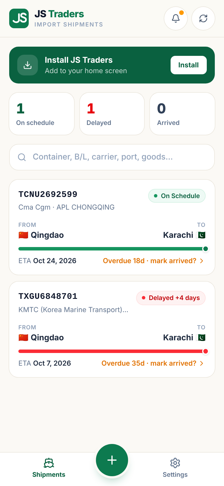

# JS Traders — Import Shipment Tracking

Mobile-first PWA for tracking JS Traders' import containers (China → Pakistan / Gulf): status, ETA, delays, voyage progress, route map and milestone history, with optional Google Sheets sync and Tracktainer live data.

**Live app:** https://ahmadok12.github.io/Container-Tracking/



## Features

- **Shipments list** – summary tiles (on schedule / delayed / arrived) that double as filters, search by container, B/L, carrier, port, goods or supplier, voyage progress bar and days-to-ETA on every card; overdue ETAs are flagged.
- **Shipment detail** – route summary, departed / ETA / days left, route map with estimated (or live, from Tracktainer) vessel position, copyable B/L, and a milestone timeline.
- **Add shipment** – container number validation (ISO 6346) and duplicate check, carrier and port pickers (Qingdao, Shanghai, Ningbo, Tianjin, Xiamen, Yantian, Nansha → Karachi, Port Qasim, Jebel Ali, Dammam, Sohar), ETD/ETA date pickers, optional vessel, voyage, supplier and goods.
- **Update status** – one-tap status chips, delay stepper, ETA / ATA date pickers, optional milestone entry.
- **Share / remove** a shipment; Android back button returns to the list.
- **Google Sheets** two-way sync via an Apps Script web app (Settings → Sheets).
- **Tracktainer API** – add your key in Settings → Tracktainer to pull live shipments (the key is stored only on your device).
- **PWA** – installable, works offline (app shell, build files and recently viewed map tiles are cached), shipment alerts.

## Development

```bash
npm install
npm run dev      # app on http://localhost:5173 + API server on :3001
npm run build    # production build in dist/
```

Optional `.env` for the local Node server:

```env
PORT=3001
TRACKTAINER_API_KEY=your_key_here
TRACKTAINER_BASE_URL=https://api.tracktainer.com/v1
```

Never commit real API keys.

## Theme

All brand colours live in `src/index.css` under `@theme` (`--color-brand-*`). Change them there to re-theme the whole app.

## Tech

React 19, Vite, Tailwind CSS 4, Leaflet (lazy-loaded), Lucide icons, Express (optional local server). Deployed to GitHub Pages by `.github/workflows/deploy.yml` on every push to `main`.
